<div align="center">

# Stockify

### Modern Inventory & Point of Sale System

A full-featured inventory and POS platform built with Ruby on Rails, designed for small and medium-sized businesses.

<p>


</p>

</div>

---

# 📖 About Stockify

Stockify is a modern inventory management and point-of-sale (POS) platform built with Ruby on Rails.

It enables businesses to manage inventory, products, suppliers, sales, users, and business accounts from a single application.

The project follows Rails best practices using Service Objects, Pundit authorization, Hotwire, and AWS S3 for cloud storage.

---

# ✨ Features

## Inventory

- Product Management
- Suppliers
- Categories
- Brands
- Stock Control
- Barcode Support (Coming Soon)
- Product Images
- Catalogs

---

## Sales

- Shopping Cart
- Point of Sale
- Sales History
- Automatic Stock Updates

---

## Administration

- Multi-business Accounts
- User Management
- Roles & Permissions
- Dashboard
- Supplier Management

---

## Security

- Google OAuth Authentication
- Authorization with Pundit
- CSRF Protection
- Secure Sessions

---

# 📸 Screenshots

## Dashboard
The Dashboard Module provides a real-time overview of business performance 
by displaying key metrics such as total sales, monthly sales, top-selling products, 
revenue trends, and growth analytics, helping users monitor inventory activity
and make data-driven decisions.

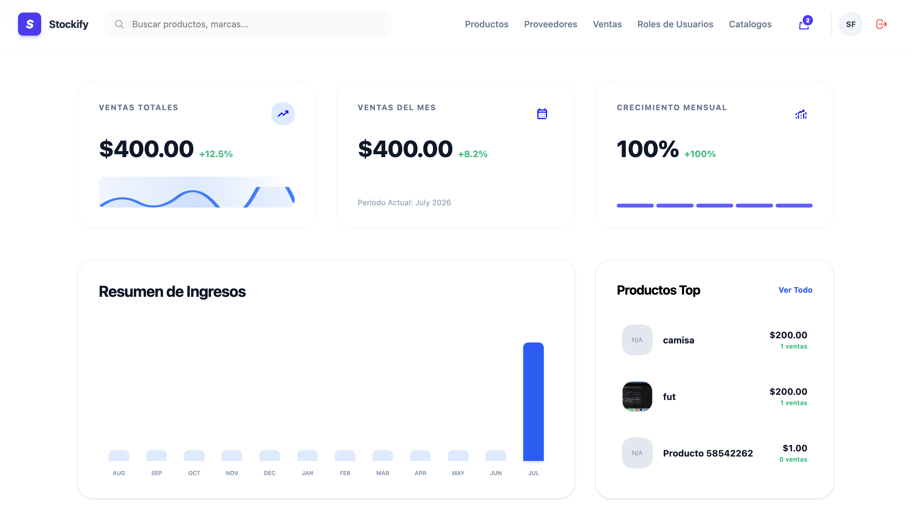

---

## Products
The Products Module provides complete inventory management, 
allowing users to create, update, search, and organize products. It includes supplier assignment, image uploads, 
stock management, barcode support, vehicle compatibility, advanced filtering, 
search suggestions, and direct product sales.

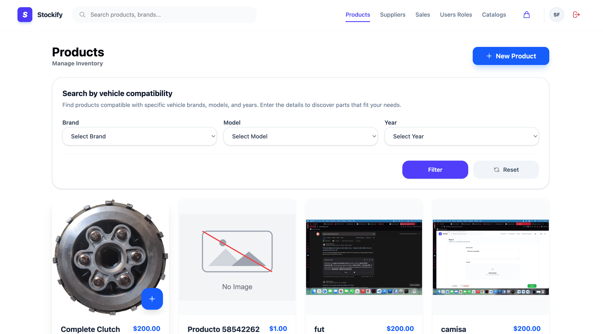
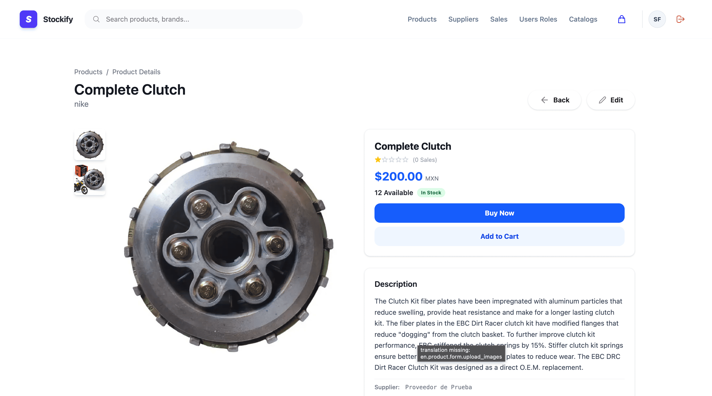


---

## Suppliers
The Suppliers Module allows users to create, manage, and organize supplier information. 
Each supplier is linked to the current account, 
providing centralized contact management and secure multi-tenant data separation.

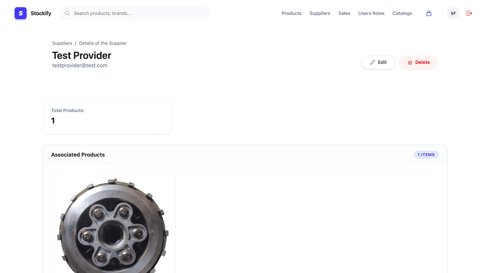
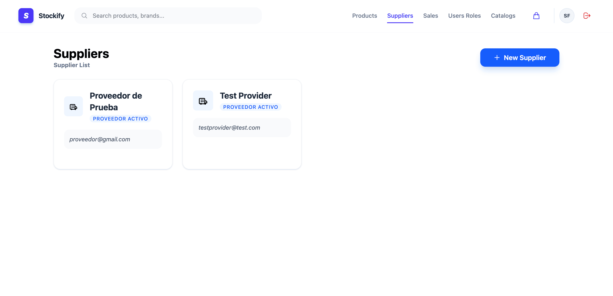

---

## Catalogs
The Catalog Module allows users to create, manage, 
and organize products into catalogs. During creation, users 
can assign products, share catalogs with other accounts, and manage 
them through an intuitive dashboard with detailed views, editing, and product tracking.


---

## Administration
The User Roles Module provides role-based access control by allowing 
administrators to assign and remove roles from users. 
It includes searchable and paginated role management, 
ensuring users have the appropriate permissions to access different areas of the system.

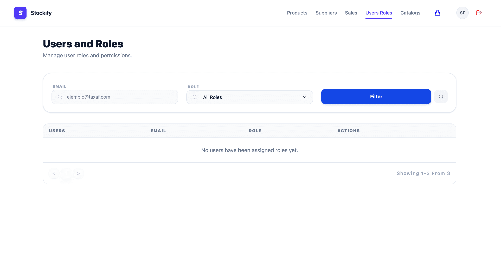
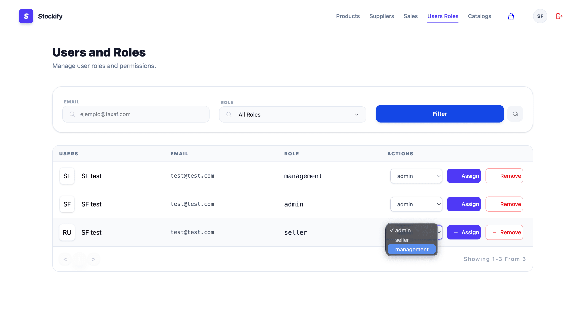

---

## Point of Sale
The Sales & Cart Module streamlines the sales process by allowing users to 
add products manually or via barcode scanning, manage cart items, 
complete purchases, generate printable receipts and PDF sales reports, and 
process refunds while automatically updating inventory.

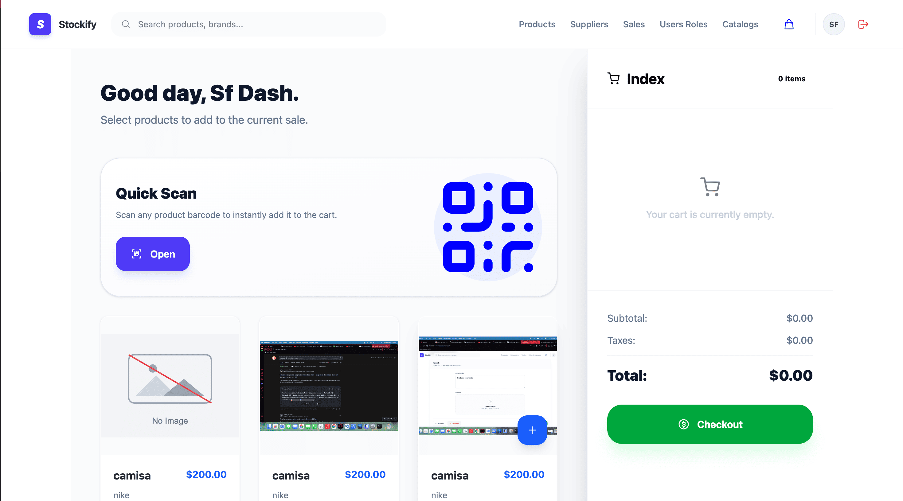
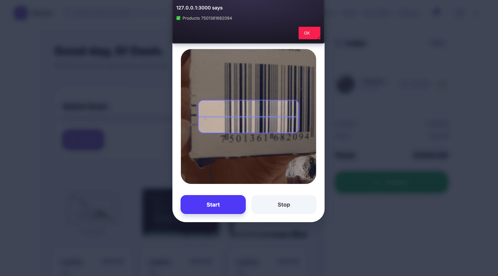
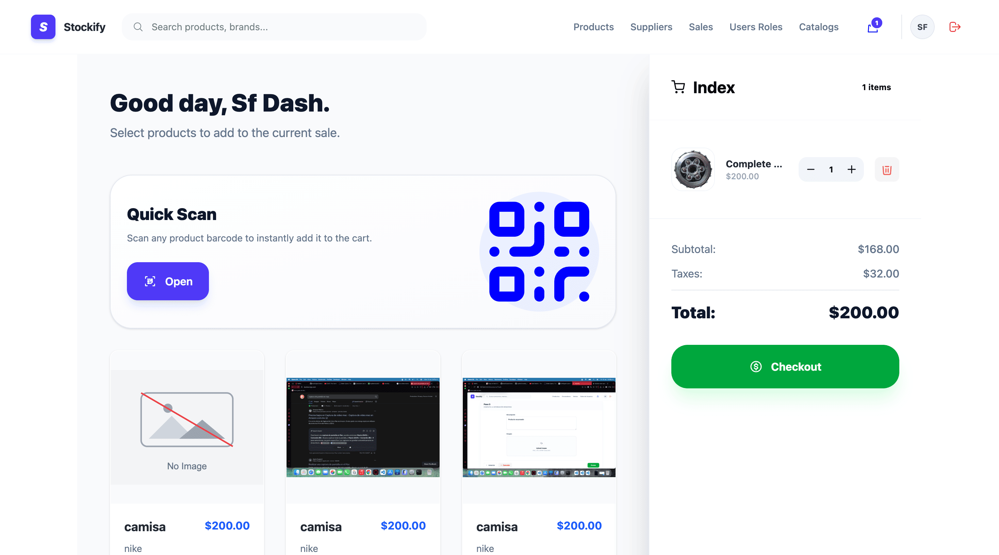
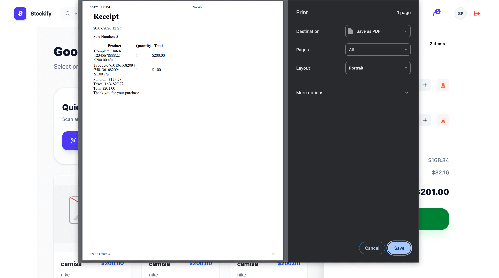
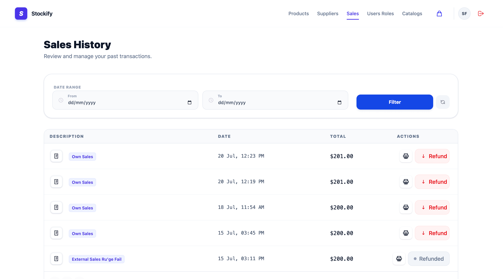

---

# 🎥 Demo

Coming Soon

---

# 🏗️ Architecture

Stockify follows the MVC architecture enhanced with Service Objects to keep business logic outside controllers.

```
Browser
      │
      ▼
Controllers
      │
      ▼
Policies (Pundit)
      │
      ▼
Service Objects
      │
      ▼
Models
      │
      ▼
Database
```

---

# 📂 Project Structure

```
app
├── components
├── domains
├── controllers
├── helpers
├── javascript
├── jobs
├── models
├── policies
├── services
├── views
├── spec
└── mailers
```

---

# 🛠️ Tech Stack

## Backend

- Ruby 3.4
- Ruby on Rails 8
- PostgreSQL
- Active Storage
- AWS S3
- Devise
- OmniAuth
- Pundit
- Sidekiq
- Active Job
- quaggajs

---

## Frontend

- TailwindCSS
- Hotwire
- Turbo
- Stimulus
- ViewComponent

---

## Testing

- RSpec
- FactoryBot
- Shoulda Matchers

---

# 🚀 Getting Started

Clone the repository

```bash
git clone https://github.com/Lopfel/stockify.git
```

Go to the project

```bash
cd stockify
```

Install dependencies

```bash
bundle install
```

Create database

```bash
bin/rails db:create
bin/rails db:migrate
bin/rails db:seed
```

Run the application

```bash
bin/dev
```

Open your browser

```
http://localhost:3000
```

---

# 🧪 Running Tests

```bash
bundle exec rspec
```

Run RuboCop

```bash
bundle exec rubocop
```

---

# 📈 Roadmap

- ✅ Product Management
- ✅ Supplier Management
- ✅ Inventory
- ✅ Shopping Cart
- ✅ Sales
- ✅ Dashboard
- ✅ Google Authentication
- ✅ Multi-user Accounts
- ✅ AWS S3 Storage
- 🚧 Barcode Scanner
- 🚧 Reports
- 🚧 REST API
- 🚧 Mobile App

---

# 📊 Future Improvements

- Export reports to Excel

- Email notifications

- Purchase orders

- Inventory alerts

- Analytics dashboard

- API documentation

---

# 👨‍💻 Author

## Kinverly Felix Lopez

Ruby on Rails Developer

GitHub

https://github.com/Lopfel

LinkedIn

(Add your LinkedIn)

---

# 📄 License

MIT License
