<div align="center">

# Stockify

### Modern Inventory & Point of Sale System

A full-featured inventory and POS platform built with Ruby on Rails, designed for small and medium-sized businesses.

<p>


</p>

</div>

---

# 📖 About Stockify

Stockify is a modern inventory management and point-of-sale (POS) platform built with Ruby on Rails.

It enables businesses to manage inventory, products, suppliers, sales, users, and business accounts from a single application.

The project follows Rails best practices using Service Objects, Pundit authorization, Hotwire, and AWS S3 for cloud storage.

---

# ✨ Features

## Inventory

- Product Management
- Suppliers
- Categories
- Brands
- Stock Control
- Barcode Support (Coming Soon)
- Product Images
- Catalogs

---

## Sales

- Shopping Cart
- Point of Sale
- Sales History
- Automatic Stock Updates

---

## Administration

- Multi-business Accounts
- User Management
- Roles & Permissions
- Dashboard
- Supplier Management

---

## Security

- Google OAuth Authentication
- Authorization with Pundit
- CSRF Protection
- Secure Sessions

---

# 📸 Screenshots

## Dashboard


---

## Products

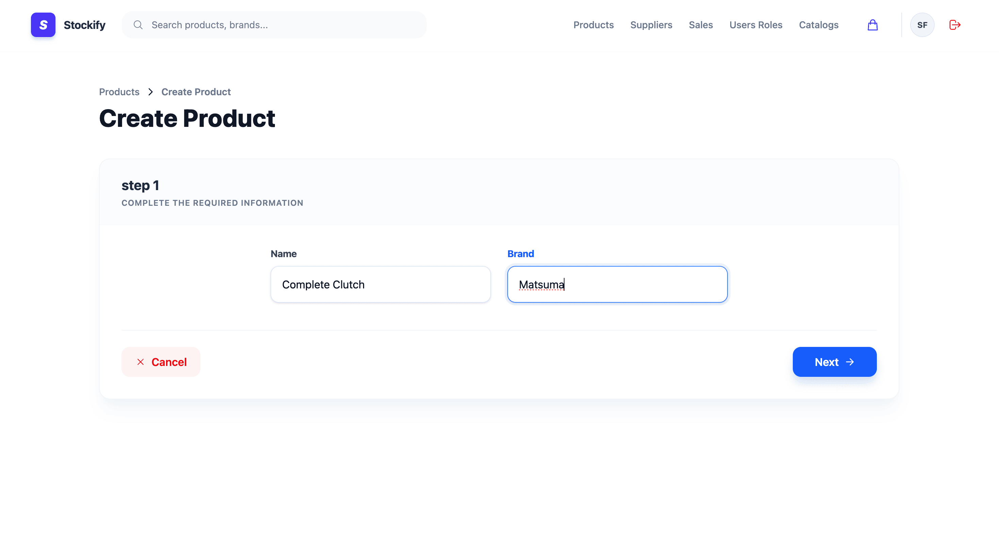
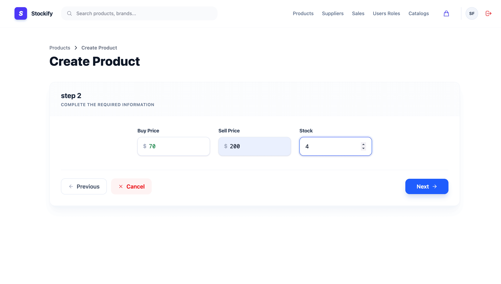
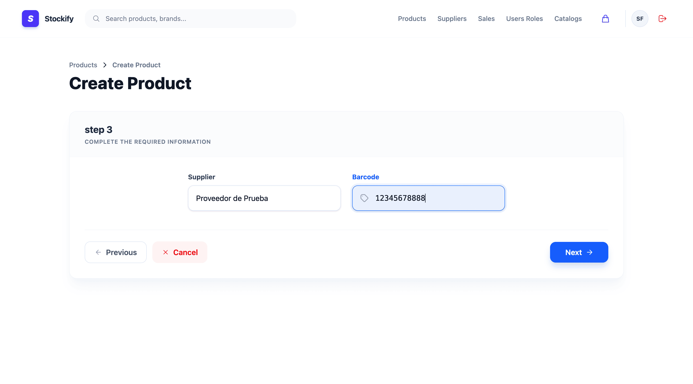
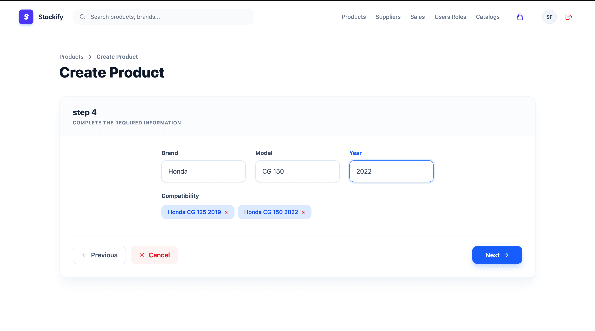
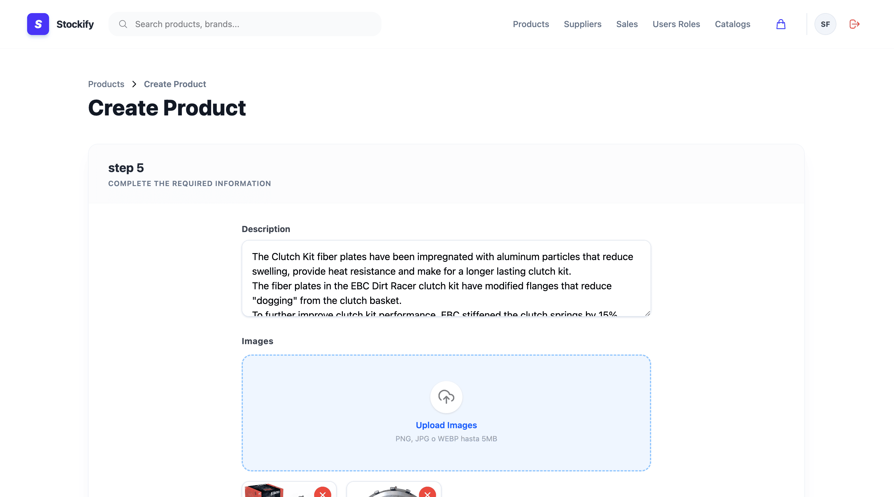
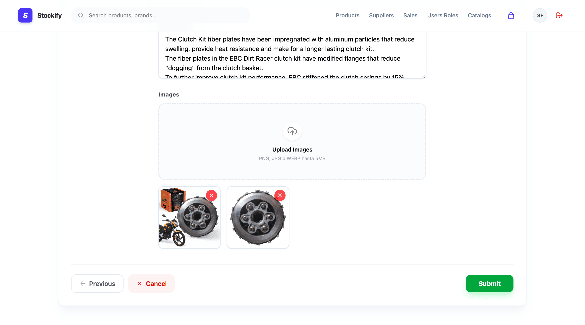


---

## Suppliers

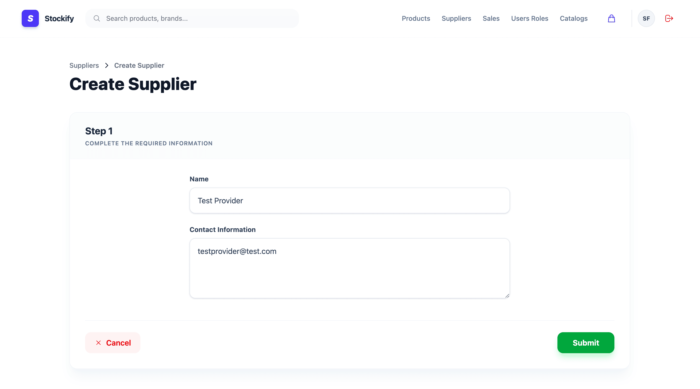
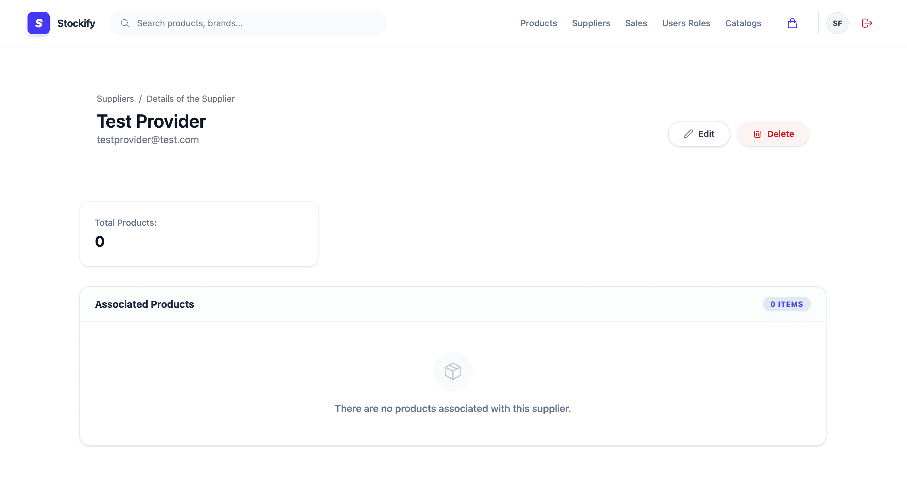

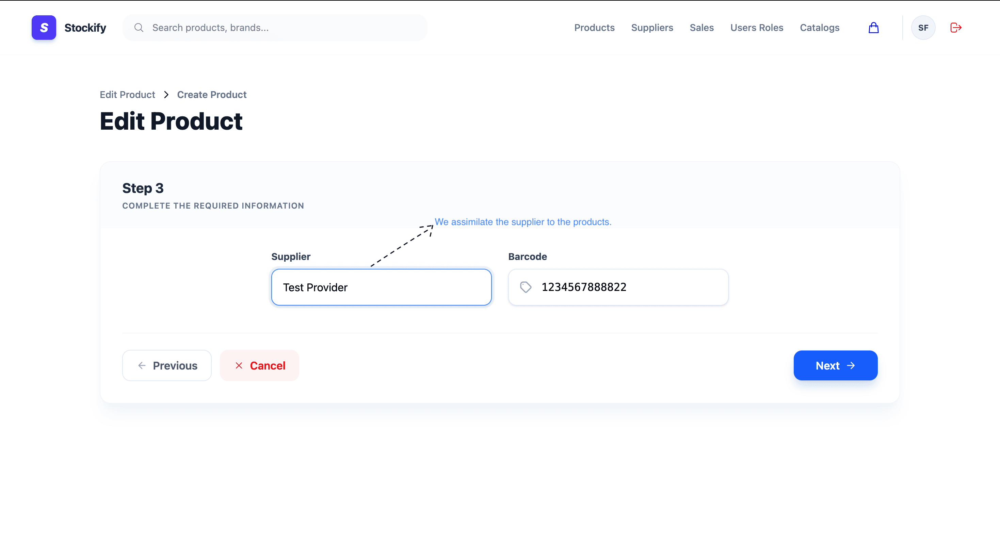


---

## Catalogs


---

## Administration


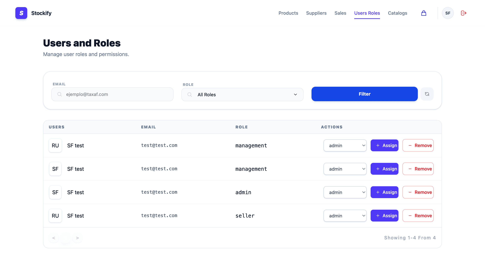
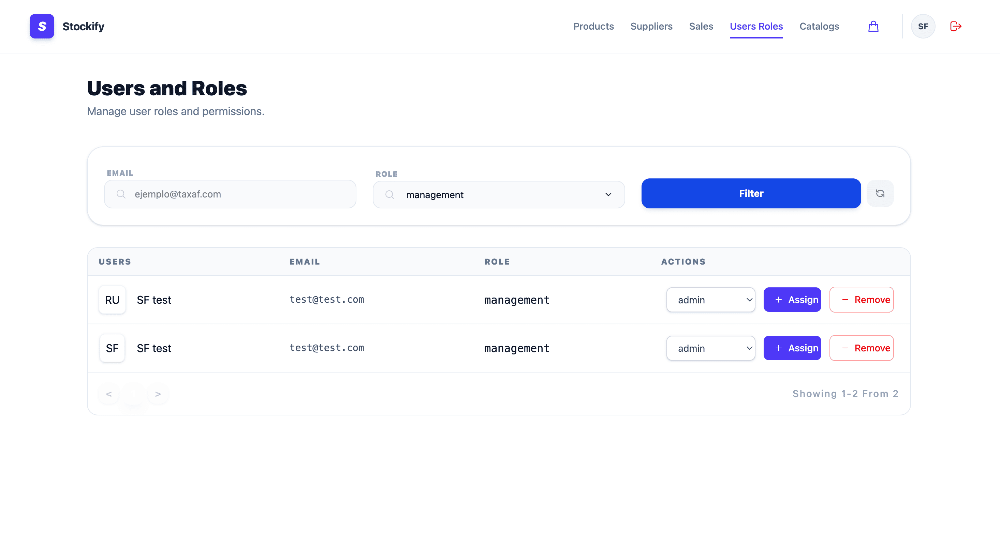

---

## Point of Sale


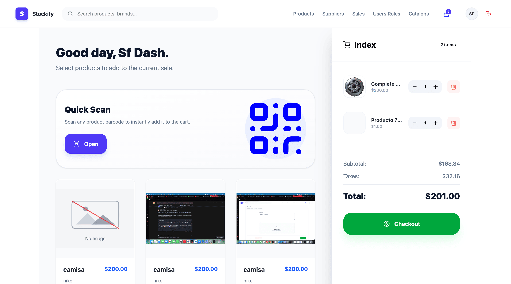


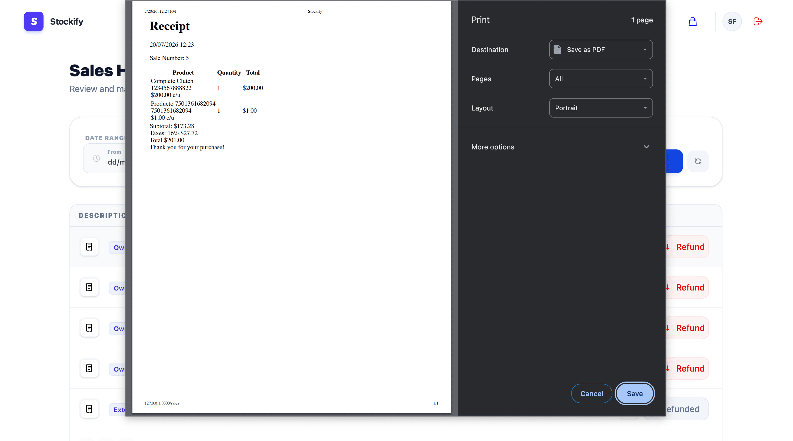

---

# 🎥 Demo

Coming Soon

---

# 🏗️ Architecture

Stockify follows the MVC architecture enhanced with Service Objects to keep business logic outside controllers.

```
Browser
      │
      ▼
Controllers
      │
      ▼
Policies (Pundit)
      │
      ▼
Service Objects
      │
      ▼
Models
      │
      ▼
Database
```

---

# 📂 Project Structure

```
app
├── components
├── domains
├── controllers
├── helpers
├── javascript
├── jobs
├── models
├── policies
├── services
├── views
├── spec
└── mailers
```

---

# 🛠️ Tech Stack

## Backend

- Ruby 3.4
- Ruby on Rails 8
- PostgreSQL
- Active Storage
- AWS S3
- Devise
- OmniAuth
- Pundit
- Sidekiq
- Active Job
- quaggajs

---

## Frontend

- TailwindCSS
- Hotwire
- Turbo
- Stimulus
- ViewComponent

---

## Testing

- RSpec
- FactoryBot
- Shoulda Matchers

---

# 🚀 Getting Started

Clone the repository

```bash
git clone https://github.com/Lopfel/stockify.git
```

Go to the project

```bash
cd stockify
```

Install dependencies

```bash
bundle install
```

Create database

```bash
bin/rails db:create
bin/rails db:migrate
bin/rails db:seed
```

Run the application

```bash
bin/dev
```

Open your browser

```
http://localhost:3000
```

---

# 🔑 Environment Variables

Create a `.env` file.

```text
DATABASE_URL=

GOOGLE_CLIENT_ID=
GOOGLE_CLIENT_SECRET=

AWS_ACCESS_KEY_ID=
AWS_SECRET_ACCESS_KEY=
AWS_BUCKET=
AWS_REGION=
```

---

# 🧪 Running Tests

```bash
bundle exec rspec
```

Run RuboCop

```bash
bundle exec rubocop
```

---

# 📈 Roadmap

- ✅ Product Management
- ✅ Supplier Management
- ✅ Inventory
- ✅ Shopping Cart
- ✅ Sales
- ✅ Dashboard
- ✅ Google Authentication
- ✅ Multi-user Accounts
- ✅ AWS S3 Storage
- 🚧 Barcode Scanner
- 🚧 Reports
- 🚧 REST API
- 🚧 Mobile App

---

# 📊 Future Improvements

- Export reports to Excel

- Email notifications

- Purchase orders

- Inventory alerts

- Analytics dashboard

- API documentation

---

# 🤝 Contributing

Contributions are welcome.

Feel free to fork the repository and submit a Pull Request.

---

# 👨‍💻 Author

## Kinverly Felix Lopez

Ruby on Rails Developer

GitHub

https://github.com/Lopfel

LinkedIn

(Add your LinkedIn)

---

# 📄 License

MIT License
